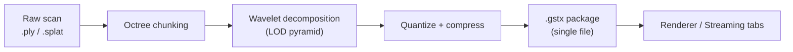
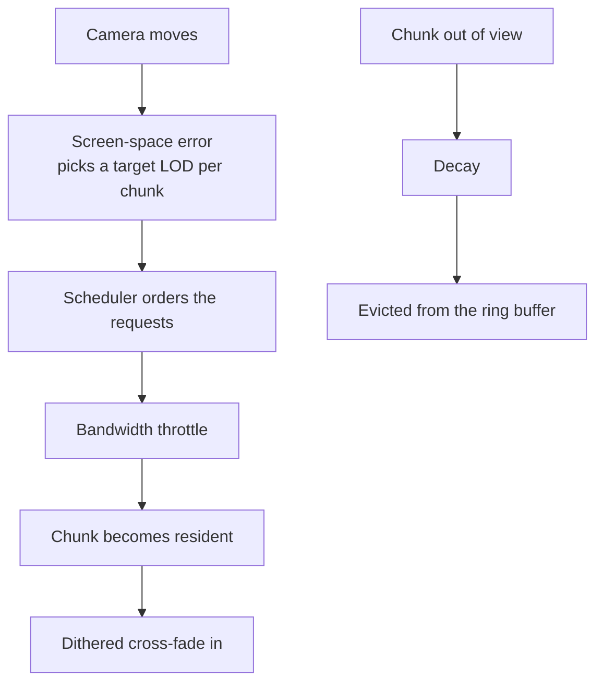
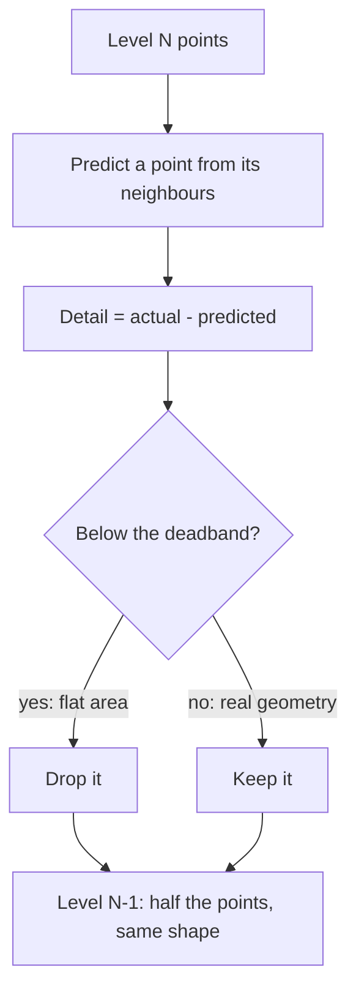

# SplatPak User Guide

This guide explains how to use SplatPak. For the architecture and build instructions, see [README.md](../README.md).

## Overview

SplatPak turns large point clouds and Gaussian splat scans into compact, multi-resolution packages, then streams and renders them on the GPU. A scan of a few million points becomes a single `.gstx` file that opens in seconds, loads coarse-to-fine as you look at it, and stays sharp where it matters.

A few concepts carry through the whole application:

- **Gaussian (splat).** A small, soft, coloured 3D ellipsoid with a position, three scales, a rotation, an opacity and optionally view-dependent colour (spherical harmonics). Everything SplatPak renders is made of them: a 3D Gaussian Splatting scene supplies its own, and a plain point cloud gets one at each point.
- **Chunk.** A spatial cube of Gaussians, a few thousand at most. Chunks are the unit of streaming: they arrive, refine and leave memory independently.
- **LOD pyramid.** Every chunk exists at several levels of detail, from a coarse envelope of a few points to the full-resolution scan. The Package/Bake tab builds the pyramid once, using a wavelet decomposition that keeps shape while it halves the point count (see the appendix).
- **Package (`.gstx`).** One self-contained file holding every level of every chunk, compressed, plus the metadata the viewer needs: the chunk manifest, an optional interior occlusion volume and a detail grid that guides streaming. Only packages of the current format (13) open; bake an older one again from its source scan.
- **Streaming.** The viewer never needs the whole file at once. Chunks are requested at the level the view calls for, arrive in a priority order, cross-fade in, and can be evicted again when memory is tight. SplatPak simulates the network so you can watch this happen.
- **Interior occlusion volume.** A solid, coloured voxel body baked inside the model. It stops the far side of a sparse scan from showing through the near side.

### One application, two modes

SplatPak ships as two executables built from the same code:

- **`SplatPak.exe`** runs in Studio mode: three tabs that take a dataset from raw scan to streamed render. **Package/Bake** loads a `.ply` or `.splat`, exposes the packaging parameters and saves a `.gstx`. **Renderer** shows the current dataset or any package with level-of-detail, visualiser and occlusion controls. **Streaming** simulates delivery over a constrained connection and shows what is resident.
- **`SplatPakViewer.exe`** runs in Viewer mode: the Renderer and Streaming tabs only, with the generator hidden. Use it where people only need to open packages.

Either executable can start in either mode with a switch, and both accept a file on the command line, so dropping a package or a scan onto the executable opens it directly.



### Command line

```bat
SplatPak.exe [options] [file]
SplatPakViewer.exe [options] [file]
```

| Option | Effect |
|---|---|
| `file` | A `.gstx` package to open, or in Studio mode a `.ply` / `.splat` to preprocess. Without it, the `startup_dataset` from `config.json` opens. |
| `--viewer` | Viewer mode: Renderer and Streaming tabs only. The default for `SplatPakViewer.exe`. |
| `--studio` | Studio mode: all three tabs. The default for `SplatPak.exe`. |
| `--render-path <p>` | GPU path for this run: `auto`, `mesh`, `vs6` or `vs5`. Overrides `render_path` in `config.json` without changing it. |
| `--help`, `-h`, `/?` | Show the usage, on the console when started from a prompt and in a dialog. |

## Getting started

**Release build.** From the [Releases page](../../../releases), run the setup `.exe` (a per-user install with Start menu shortcuts, no administrator prompt), or extract the zip anywhere and run `Run SplatPak.cmd`. The bundled Cthulhu statue loads on first launch, so the window is never empty.

**Hardware.** Any Direct3D 12 GPU works. GPUs with mesh shaders (GeForce RTX 20-series or newer, Radeon RX 6000 or newer, Intel Arc) run the fast path. Other hardware falls back to instanced vertex shaders automatically, drawing the same picture at lower frame rates. When the fallback is active a dialog says so at launch, the top-left banner lists the stages it stands in for, and Help > About names the path in use.

**Building from source.** The Building section of [README.md](../README.md) has the full procedure. In short: run `cmake .. -G "Visual Studio 18 2026" -A x64` from a `build/` directory and open the generated solution. SplatPak is the startup project.

**Camera.** Left-drag or the Left/Right arrows rotate. The mouse wheel, right-drag, W/S or Up/Down zoom. Shift with any drag or with the arrow keys pans. A faint reminder sits in the bottom-right corner of the viewport, and **Show Camera Control Hints** on the Renderer tab hides it. **Reset View** in the bottom-left corner returns to the launch view.

**Menus.** Every section header folds with a click; Temporal Filtering & Anti-Aliasing (TAA) has its own section on the Renderer tab. The tab shown, each folded header, the side panels and the order of the statistics sections are remembered across sessions (in `config.json`).

**The banner.** Whenever a toggle changes what the viewport shows, a row at the top-left names it, as in `RENDERER: Hide Splat Layer enabled`. If the picture looks wrong, read the banner first: it names the tab and control responsible, and turning that control off restores the normal view. A red `CODEC:` row means the build is running the open stand-in codec rather than the bundled `gstx` library, and lists what that build lacks.

## Package/Bake tab

This tab converts a point cloud into a `.gstx` package.

1. **Open Raw Point Cloud** picks a `.ply` or `.splat` file. **Generate Synthetic Benchmark** builds a procedural street scene to experiment with.
2. Adjust the parameters. Every control is live. The chunking and wavelet sliders re-run the pipeline when you release them, and the occlusion volume controls rebuild the volume while you drag.
   - **Octree Chunk (m)** sets the edge length of each chunk. Smaller chunks stream at a finer grain but there are more of them.
   - **Max Wavelet LODs** sets how many detail levels to build. More levels give a smoother fall-off with distance and take longer to process.
   - **Deadband Zero (mm)** is the threshold below which near-flat detail is discarded. Higher values give smaller files and softer close-up detail.
   - **Rate Distortion Optimization** chooses the encoding of the view-dependent colour (spherical harmonics) for a size or quality you set. **Analyse** measures every encoding of this scan -- SH degree 1 to 3, and 8, 6, 5 or 4 bits per band, uniform or finer for the low bands -- for its package size (as Save would compress it; within about 1% of the saved file) and its colour fidelity against the source, then draws the scan's size-against-quality curve: package size across, colour fidelity (dB) up, the best encodings joined. It takes about a minute for a 3-million-splat scan; a progress bar in the menu and the progress dialog show the stage, elapsed time and the time left, and Cancel stops it. Click or drag on the curve to pick a point, or set a target: **Size** (the best quality within so many MB), **Ratio** (so many times smaller than the source), **Quality** (the smallest package that keeps so many dB), or **Streaming time** (a network, the time to the first view -- the two coarsest levels -- and the time to full detail). The line below gives the result: size, ratio, fidelity, the settings it implies and, where it would help, how much per-region settings could save. **Override settings** sets SH Quality and SH Precision by hand instead (these are also the controls before an analysis). Bake applies the choice. On Cthulhu, degree 3 at 4 bits is 41% smaller than 8 bits with no difference measurable in rendered views, while degree 2 costs about 11 dB. **Save Profile** writes the analysis, the target, the settings and the scan's content hash to a `.rdoprofile` file; **Load Profile** applies one to the scan open now, or opens the `.ply` it names when that file is unchanged (any other scan is refused).
   - Bake settings are remembered per scan: every bake of a `.ply` stores its settings (chunk size, levels, SH degree and bits, deadband, occlusion) against a hash of the file in `bake_tunings.json`, beside `config.json`, and opening the same unchanged file bakes with them again. A changed file is a new scan and starts from the defaults.
   - Every source bakes as 3D Gaussians: a 3D Gaussian Splatting scene (a `.ply` with scales, rotations and opacities, or a `.splat`) keeps its own Gaussians, and a plain point cloud (a `.ply` with positions and colours only) gets an isotropic Gaussian at each point, sized from the cloud's point spacing, with no view-dependent colour. Each Gaussian is a 20-byte record plus its harmonics. The renderer draws a package as sorted Gaussians, the way a reference splat viewer does. How much view-dependent colour to keep, and at what precision, is set in the **Rate Distortion Optimization** menu below. Every package also stores each level's harmonics as the difference from the coarser level's, which is lossless and makes Cthulhu's package 22% smaller on its own. After Bake the viewport shows exactly what the package will hold, so you can judge it before saving.
   - **Generate Interior Occlusion Volume**, on by default, bakes a solid, coloured voxel body of the model, stored as a compact octree with a chain of coarser levels. The cell size follows the point density. Stray points away from the surface are ignored, and cubes that would show through the splat surface are removed automatically, so the volume never clips outside the model. The panel reports the resolution chosen, the block count of each level and how many cubes were removed. If a scan still shows cubes poking through, the `occlusion_shave_bias` key in `config.json` widens that removal. A package stores the volume as a smooth mesh of about 6,000 triangles instead of the cubes; it is built with the shadow mesh after a bake and replaces the cubes in the viewport when ready.
   - **Hue Shift**, **Saturation** and **Brightness** grade the volume's colour, live: the cubes show it while you drag and the occluder mesh takes it when you let go (or at Bake, when a shave is waiting). The defaults of 0, 1 and 1 leave the sampled colour as it is. The graded colour is written into the package.
3. **Save Compressed Package (.gstx)** writes the result with the current parameters.

The output is one `.gstx` file. Open it in the Renderer tab, reload it later, or hand it to someone with the viewer.

## Renderer tab

This is where you examine a model. The controls that matter most:

- **Auto Distance LOD**, the default. Camera distance picks the detail level per chunk, so the model refines as you approach. Turn it off to hold a level by hand.
- **Dithered LOD Transitions** replaces the switch between levels with a soft dissolve.
- **Refinement Visualizer**, on by default, tints every chunk as it arrives, also in Gaussian splat mode. Each arriving chunk glows in its level's tint, bright and near white at first, then fading out smoothly over the fade duration (2.5 s by default). Consecutive levels take colours across the colour wheel from one another (level 0 gold, level 1 azure, level 2 green, level 3 violet, ...), and a legend under the sliders shows them. Sliders set the fade duration, glow intensity (0.25 by default) and a hue rotation of every level's tint. Press **Evict** on the residency panel and watch the model grow back.
- **GPU Silhouette Edge Refinement** keeps outlines crisp while the interior of the model is still coarse.
- **Splat Blending**, shown for Gaussian splat packages. **Display space** blends the stored colours as they are, which is what the training rasterizer and SuperSplat do, so the picture matches those viewers. **Linear** decodes the colours first and blends in linear light, which is physically tidier and slightly different. In this mode the splats are sorted back to front every frame on the GPU.
- **Match Level 0 Softness**, shown for Gaussian splat packages; on by default. The coarser levels of a splat package are drawn as camera-facing discs, and this sizes those discs from the level 0 Gaussians themselves: the read-out beside the checkbox shows how wide the typical level 0 Gaussian is relative to the level 0 point spacing (the softness ratio) and the disc radius, as a multiple of each level's own spacing, that gives the discs the same softness. Discs of level 1 and up also take an opacity floor so a faint record does not read as a hole. The effect is a streamed model that reads as one surface while it refills, with a less visible hand-over from discs to Gaussians. Off, the discs are 1.5 times the level spacing with each record's opacity as is. Remembered across sessions.
- **Detach Camera** (Ctrl+D) freezes the culling camera where the view is and steps the view aside so you can inspect the culling from any angle. The model is exactly what the frozen camera would render, its level of detail included: Gaussians it would draw keep their colour, mid grey where you see their backs, and everything it would have culled, including the far half of the model beyond its centre, stays on screen as a translucent red volume, depth-tested against your view so it never builds up. Streaming keeps running from the frozen camera's point of view, so Evict refills the model as that camera would see it. The occlusion volume shows only the faces turned toward the frozen camera, and its frustum is drawn. While the camera is detached the arrow keys turn the model only, never the view: Left and Right turn it about its vertical axis, Up and Down tilt it toward or away from you, and what the frozen camera culls follows it.

**Interior Occlusion Volume.** **Enable Occlusion Volume**, on by default, depth-tests the Gaussians against the volume, so the far side of the model does not show through the near side. On a package with a shadow mesh, the mesh also fills the gaps between sparse splats with the model's colour. On a loaded package the volume is that mesh, and the cube controls below do not appear. **Hide Splat Layer** hides the splats so the solid shows alone, for comparison with the model. When the package carries several levels, an **Occlusion Volume Mip** selector appears. On **Auto** the renderer picks one level per frame from how large its cells are on screen, so the volume coarsens as the model does. Choosing a level forces it, which is handy with Hide Splat Layer. These are rendering options, so they live on the Renderer tab; shape and colour are set when the package is baked, and the Package/Bake tab has those sliders.

**View Shadow Mesh.** Every package carries a shadow mesh: a smooth, closed mesh following the model's visible surface, in three levels of detail, coloured from the splats. Unreal uses it to cast the model's shadow, for Lumen and for collision. **View Shadow Mesh** (on the Renderer tab, under the occlusion volume controls) draws it, solid and shaded, in place of the splats, with a selector for the level. After a bake of a scan the mesh is built in the background, usually within a few seconds; Input Model Metrics shows "building" until it is ready, and a save waits for it. 

## Streaming tab

This tab simulates delivery over a constrained connection. It is useful for demonstrations and for stressing the level-of-detail system.

- The tab is grouped under three headings: **Network Bandwidth**, **Stream Load** and **Scheduler**. **Network Bandwidth** offers 3G (0.2 MB/s), 4G (2 MB/s), 5G (7.5 MB/s) and Full presets, each button showing its rate and the selected one lit, or a slider for any bandwidth. Streaming is unthrottled until you pick one.
- **Decay Rate** sets how fast detail that is out of view drains from memory. 0 disables decay. 10 drains every evictable level in about ten seconds whatever the bandwidth, and 5 takes twice as long. Hover over the slider for the implied drain time. **Evict** clears everything but the two coarsest levels at once.
- **Release Unused LOD Segments**, on by default, evicts a level's segments as soon as nothing draws them any more. Zoom out, or turn away, and the finer segments fade back to their coarser parents, then leave memory, so the residency map frees up. The two coarsest levels always stay resident. Off, everything that arrives stays.
- **Policy** decides what streams besides the view's own requests. **Conservative**, the default, loads only what the view needs: blocks in view (plus a small margin) on the side of the model facing the camera, each down to its own level, and nothing in the background. **Greedy** carries on loading in the background regardless of the view, faces in view first, until the whole model is resident. With Release Unused LOD Segments on, Greedy loads every block of every level down to the finest level a visible block renders at, across the whole model, and releases only what lies finer, so nothing it loads is released and fetched again.
- **Prioritize View Frustum & Proximity** lets the current view reorder the scheduler's ranking so in-view regions arrive first. Off, the scheduler's model-wide order applies.
- **Encoding** shows how the model on screen was baked: the package and its size, SH degree, SH bits per band, LOD levels, blocks at full detail and the occlusion volume. It checks them against the selected network profile and the time targets of the Rate Distortion Optimization menu: the first picture (the two coarsest levels) and full detail, in MB and seconds. Without an RDO analysis of the scan the times are the whole model's; with one they are a typical close view's, as the RDO target uses, and the panel also says which encoding the analysis would pick for that network. A row that should be baked differently gets a yellow warning triangle; hover over it for the reason and the fix. Typical warnings: a first picture slower than the target (one more level makes the envelope smaller), reduced SH precision on Full bandwidth, too few blocks for view-first streaming, no occlusion volume. **Re-encode for** *profile* fixes them: it finds the package's source scan (beside the package with the same name, or remembered in `bake_tunings.json`; **Locate...** picks it otherwise), asks before replacing the package, then opens the scan, bakes with the structural fixes, analyses the compression for that network when it has not been analysed (about a minute), bakes with the analysis's pick, saves, remembers the settings for the scan and opens the new package.
- Every compression analysis is kept in the `rdo-profiles` folder at the project root, as `<scan>_L<levels>_D<deadband>.rdoprofile` (numbered when the name is taken). Before analysing, SplatPak looks there for an identical one: the same scan (by content hash), the same levels and deadband, and the same analysis settings. If it finds one it uses that instead, in about a second; otherwise it analyses and stores the result. Every bake of a scan looks there too: return to levels and a deadband analysed before, and the curve comes back by itself (the target and the SH settings stay as they are). Re-encode's confirmation names the profile it will store, or the stored one it will reuse.
- Save puts the analysis behind the encoding into the `.gstx` itself, after the package data (other readers do not see it, and the format version is unchanged). Opening that package brings it back: the Encoding panel then shows a typical close view's times and the encoding the analysis would pick for each network, even without the `.ply`, and a re-encode with the same settings reuses it instead of analysing again.

**Streaming order.** The two coarsest levels always land first, so there is a solid envelope. Silhouette chunks come next. After that the streaming scheduler, part of the `gstx` core, decides what streams. The model is wrapped in a bounding octahedron and every chunk belongs to the face in front of it. Each frame, the faces the camera can see stream together, faces out of view wait, and a face starts streaming the moment it comes into view. A detail grid baked into the package lets the scheduler favour some regions over others. The tab draws the octahedron as two diamonds, green for the upper faces and blue for the lower ones, with the faces the camera sees lit (brighter the more squarely they face it), faces turned just away half lit (they stream with the visible ones, so a face is already loading as it turns into view; the label counts them separately), an inner triangle growing as each face fills, and a yellow dot for the camera's direction. Builds running the open stand-in codec stream in plain chunk order instead and say so in the banner.

The **LOD Residency** panel on the right shows which chunks are resident, in transition or silhouette-locked at each level. Green bars filling in are streaming made visible.

**Refinement pacing.** However fast data arrives, the model refines gradually: detail dissolves in chunk by chunk instead of snapping, and a region keeps showing its coarser level until its finer one is ready to fade in, while the data keeps arriving at full speed. The tab reports the transitions in progress and how many were held back this frame.



## Statistics panel

The right-hand panel is ordered by how often each section is consulted:

1. **Real-Time Performance & Stage Timings.** Frame rate, a per-stage GPU breakdown (upload, sort, silhouette prepass, occlusion pass, main dispatch, TAA) and a CPU frame budget. When performance drops, this names the stage responsible.
2. **5-Tier Compression Results.** The size of the original scan against the size of the package, with the contribution of each stage. The original size is stored in the package, so the ratio survives a reload. It reads as a bordered table with shaded rows: the tier, what it measures, and its **Ratio** to the tier before (the tier before over this one, as a percentage: 200% is half the size, or entropy, of the tier before). Every cell has its own tooltip. Tier 3 is the layout (records in Morton order, then split into byte planes) and Tier 4 the lossless value transforms (colour as YCoCg, each level's view-dependent colour as the difference from the coarser level's). Both only rearrange or recode bytes, so they show entropy rather than size: bits per byte a simple coder would need, with the reduction from the tier before. Plain order-0 entropy cannot show Tier 3 (reordering bytes leaves a histogram unchanged), so each byte plane is measured as the better of its own entropy and that of its deltas from the previous record; Morton order makes neighbouring records alike, which lowers the deltas. The figure is measured on a sample of the bake, or of a loaded package's chunks (under a second). Hover over Tier 4's value for the size the codec receives (every level's records and view-dependent colour, uncompressed, about twice the level 0 data of Tier 2) and, after a bake, the drop in compressed size the transforms bring, which is what the file actually saves. Tier 5's tooltip gives the bits per byte Brotli actually reaches. Tier 5 is the codec, Brotli, with the package's size and its ratio to Tier 4. The save dialog shows the entropy figure for the full data while it compresses.
3. **LOD Residency.** Described above.
4. **Wavelet Pyramid.** Click a row to view that level.
5. **Input Model Metrics**, **Geometry Optimisations & Culling Stats**, **Spatial Partitioning.** Diagnostics you can ignore in ordinary use.

## Common issues

- **The model shows a single LOD level.** The package came from an older version, or **Max Wavelet LODs** was 1. Re-export with more levels.
- **A package refuses to load.** The dialog names the reason: wrong file type, a newer format version, a truncated file, or a package baked with a different codec build. Retry with a fresh copy, or re-bake it from the original scan.
- **Decay never finishes.** At rate 10 every evictable level drains in about ten seconds. What remains is pinned: the two coarsest levels never drain, and silhouette chunks in view stay locked while GPU Silhouette Edge Refinement is on.
- **Edges look blocky up close.** Raise **Silhouette LOD Bias**, or check that GPU Silhouette Edge Refinement is on.
- **The picture looks wrong.** Read the top-left banner. It names every active debug view, isolation mode, forced level and frozen state.

## Glossary

- **Gaussian (splat).** A soft, coloured 3D ellipsoid; the primitive everything is drawn with.
- **Chunk.** A spatial cube of Gaussians, the unit of streaming.
- **LOD (level of detail).** A coarser or finer version of the same chunk. The wavelet pyramid holds several.
- **Silhouette chunk.** A chunk on the model's outline from the camera's point of view. These refine first.
- **Occlusion volume.** The solid voxel body baked inside the model so its far side cannot show through.
- **Detail grid.** A coarse grid stored in the package that the streaming scheduler reads.
- **Decay.** The simulated cache eviction that drains unused detail from memory.
- **Residency.** Which chunks, at which levels, are currently held in the GPU ring buffer.

## Appendix: wavelet compression

Each coarser level of the pyramid is not the finer level with every other point deleted. It is built with a second-generation lifting wavelet, the family of technique used in JPEG 2000, which discards detail selectively and keeps the overall shape through several halvings.

For each pair of neighbouring points, the position of one is predicted from its neighbours. The difference between the prediction and the real position is a detail coefficient. On flat surfaces the prediction is nearly perfect and the coefficient is tiny. Any coefficient below the **Deadband Zero (mm)** threshold is set to zero and costs nothing to store, which is why walls, roads and torsos compress so well. The surviving point carries the level below it, and the process repeats until **Max Wavelet LODs** is reached or too few points remain to split.


