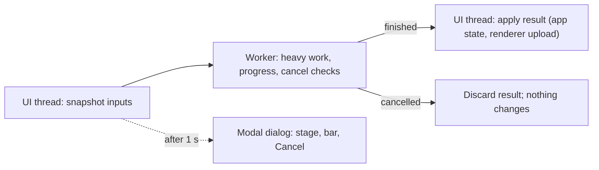

# Design: Bake button and modal progress

Requirements: docs/requirements/bake-button-progress.md
Status: agreed
Date: 2026-10-25

## Summary
Long operations (bake, open scan, open package, save) are split into three parts: a snapshot of their inputs on the
UI thread, the heavy work on one worker thread, and an apply step back on the UI thread that swaps the result into
the app and the renderer. A small framework in `src/SplatCore/BackgroundOp.h` runs them, carries progress and a
cancel flag, and shows a modal ImGui dialog once an operation has run for one second. The bake tab compares the
current parameters with the ones the displayed model was baked with; a difference enables the Bake button and
disables Save. The colour grade stays a live, synchronous recolour. Scripted runs call the same three parts
synchronously, with no dialog.

## Components touched
| Area | Files | Change |
|------|-------|--------|
| Framework (new) | `src/SplatCore/BackgroundOp.h` | `Progress` (atomic stage name, fraction, cancel flag), `BackgroundOp` (worker thread, elapsed time, result), `RunModal` (starts it; the dialog appears after 1 s) and `RunNow` (synchronous, for scripted runs) |
| Bake | `src/SplatCore/SplatPakApp.cpp/.h` | `BakeParams` struct (chunk size, LODs, SH quality, deadband, occlusion on/off, shave) with `operator==`; `m_bakedParams`; `RecomputeWaveletHierarchy` split into `SnapshotBake`, `RunBake(BakeInput, Progress&) -> BakeResult` and `ApplyBake(BakeResult)`; Bake button and pending line; Save disabled while pending |
| Occlusion | `src/SplatCore/SplatPakApp.cpp` | The structural rebuild (grid, shave) moves into `RunBake`; the colour grade keeps its synchronous recolour from the cached grid |
| Open | `src/SplatCore/SplatPakApp.cpp` | `LoadPLYFile`/`LoadSPLATFile` parse on the worker and apply on the UI thread; `LoadSFLWFile` decodes (`StreamPackager::LoadPackage`) on the worker and applies (renderer, metrics) on the UI thread |
| Save | `src/SplatCore/SplatPakApp.cpp`, `src/SplatCore/StreamPackager.h` | Save runs `PackageDataset` on the worker into `<name>.gstx.partial`, renamed on success and deleted on cancel or failure; `PackageDataset` and `LoadPackage` take an optional progress callback, called once per chunk |
| Dialog | `src/SplatCore/SplatPakApp.cpp` | One modal popup drawn every frame while an operation runs: title, stage, progress bar, Cancel |
| Scripted runs | `src/SplatCore/SplatPakApp.cpp`, `AppEntry.cpp` | `--lod-calibration`, `--stream-test` and a command-line file use `RunNow` |

## Data flow

Only one operation runs at a time; while it runs, the rest of the UI is blocked by the modal dialog, so no input can
change the inputs the worker is reading. The renderer keeps drawing the previous model until apply.

## Cancel
- The worker checks the cancel flag between stages and once per chunk or level.
- A library call that cannot be interrupted (the occlusion volume build) runs to its end; the dialog closes at
  once on Cancel and the late result is discarded when it arrives, so the UI returns within about a second.
- A new operation waits for a cancelled one's worker to finish before starting (normally well under a second).

## Render path impact
- mesh, VS SM6, VS SM5 (FXC): no shader or pipeline change. All three keep drawing the current model while an
  operation runs; apply swaps the buffers exactly as today's rebuild does.

## Public / private placement
All public app code. The library calls an operation makes are unchanged and are only moved onto the worker; none
of them touches app or renderer state, so they are safe there.

## Decisions
- **One worker, one operation, modal** (requirements): no concurrent edits, so no locking of app state beyond the
  snapshot and the apply step.
- **Dialog after one second**: quick operations don't flash a dialog (criterion 7).
- **Cancel abandons rather than interrupts uninterruptible stages**: keeps library interfaces unchanged and still
  returns control within a second.
- **Save writes a `.partial` file and renames it**: a cancelled or failed save never leaves a broken package.
- **Progress inside StreamPackager by callback**: the packager loops per chunk already; a callback gives the save and
  open bars real progress without moving code.
- **Colour grade stays synchronous** (user): it only recolours the cached grid, which takes milliseconds.

## Test plan
- Bake equivalence: for Cthulhu and Dwarves at two parameter sets, per-level splat counts, chunk count and
  occlusion block count from Bake match the current build's live rebuild (criterion 3).
- Pending state: trace lines for "bake applied" and "parameters changed, pending" (criteria 1, 2, 5).
- Dialog: open `cthulu.ply`, bake, save, open `cthulu.gstx`; screenshots of the dialog and a check that the window
  title never shows "Not responding" (criterion 6); open `dwarves.gstx` shows no dialog (criterion 7).
- Cancel: cancel each operation mid-way; the trace shows the previous model kept and no `.partial` file left
  (criterion 8).
- Scripted runs: `--lod-calibration` and `--stream-test` complete unattended; their results match the last
  baselines (criterion 9).
- Viewer: open a large package in SplatPakViewer (criterion 10).
- Timing: Cthulhu bake time against today's rebuild (criterion 11).
- Existing tests (TestLoadPackage, TestSplatCodec, TestOcclusionVolume, TestStreamRuntime, CompressVenus) and
  `tests/stress_test.py` must pass; the console tools use StreamPackager directly and are unaffected.

## Risks
- **Hidden UI-thread state in the rebuild**: the split must find every member the rebuild reads; anything read on
  the worker comes from the snapshot only. Mitigation: `RunBake` is a static function over `BakeInput`.
- **GPU upload on the worker**: forbidden; all renderer calls stay in apply. Mitigation: `RunBake` and the load and
  save workers take no renderer pointer.
- **Shutdown during an operation**: closing the window cancels and joins the worker before teardown.
- **Memory**: a bake holds both the old and the new model until apply (about twice the model's CPU memory, brief).

## Implementation brief (for the coder agent)
1. `src/SplatCore/BackgroundOp.h`: `Progress`, `BackgroundOp`, `RunModal`, `RunNow`. Done when: a test op with
   sleeps shows the dialog after 1 s, updates the bar and cancels.
2. `SplatPakApp`: `BakeParams`, `m_bakedParams`, and the split of `RecomputeWaveletHierarchy` and the occlusion
   rebuild into snapshot / run / apply. Done when: criterion 3 holds.
3. Bake tab: parameters stop rebuilding; Bake button, pending line, Save disabled; colour grade stays live. Done
   when: criteria 1, 2, 4, 5.
4. Open: PLY/SPLAT and package loading split into worker and apply. Done when: criteria 6 and 7 for opening.
5. `StreamPackager.h` progress callbacks; Save through `.partial`. Done when: criteria 6 and 8 for saving.
6. Modal dialog and Cancel for every operation; shutdown joins the worker. Done when: criterion 8.
7. Scripted runs use `RunNow`; Viewer gets the dialog for opening. Done when: criteria 9 and 10.
8. Timing check. Done when: criterion 11.
