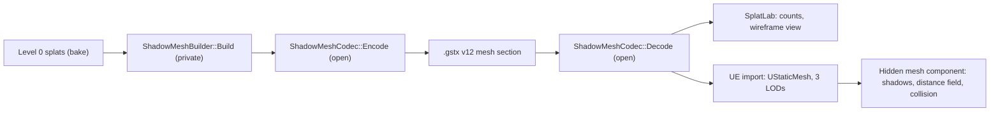

# Design: Shadow mesh baked into GSTx packages

Requirements: docs/requirements/gstx-shadow-mesh.md
Status: implemented (see "As built" in the design)
Date: 2026-10-25

## Summary
Saving a package bakes a smooth, closed shadow mesh from the level 0 splats in the codec library, in three levels
of detail, and writes it as an optional section of a new format version (12; version 11 is colour decorrelation). Every reader loads the section
through the library's open decoder. SplatLab reports the triangle counts and can draw the finest level as a
wireframe debug view. UE5Splats' importer turns the section into a hidden static mesh asset (three classic LODs,
no Nanite) that the splat component uses for shadows, Lumen's distance fields and collision. Packages without the
section load exactly as before.

## Components touched
| Area | Files | Change |
|------|-------|--------|
| Library API (public) | `libs/gstx/ShadowMesh.h` (new) | `ShadowMesh` (levels of positions and triangle indices) and `ShadowMeshBuilder::Build(points, attributes, bounds, params, out, stats)` |
| Library implementation (private) | `libs/gstx/ShadowMesh.cpp` (new) | Builds the mesh; method in `docs/private/gstx-shadow-mesh-design.md` |
| Section codec (open) | `libs/gstx/ShadowMeshCodec.h/.cpp` (new) | Encodes and decodes the mesh section (quantised positions, indices, Brotli); used by every writer and reader |
| Open stand-in | `scripts/public-release-stubs/libs/gstx/ShadowMesh.cpp` (new) | `Build` returns false: stand-in builds write no section |
| Library build | `libs/gstx/CMakeLists.txt`, stub `CMakeLists.txt` | Add the new sources |
| Format | `src/SplatCore/WaveletTypes.h`, `docs/GSTX_FORMAT_SPECIFICATION.md` | Version 12; header gains `shadowMeshOffset` (u64) and `shadowMeshBytes` (u64); spec gains a clause for the section |
| Packager | `src/SplatCore/StreamPackager.h` | `PackageDataset` takes an optional `const ShadowMesh*`; `LoadPackage` decodes the section into `SFLWPackageData::shadowMesh` |
| Bake | `src/SplatCore/SplatLabApp.cpp/.h` | Build the mesh on save; status line and Input Model Metrics counts; `Show Shadow Mesh` checkbox (config key `show_shadow_mesh`) with a banner row |
| Renderer | `src/SplatCore/SplatRenderer.cpp/.h`, `src/SplatCore/Shaders/ShadowMeshWire.hlsl` (new) | A line-list pass that draws the finest level over the splats, depth-tested |
| Tools | `tests/CompressVenus.cpp`, `tests/TestLoadPackage.cpp`, `tests/TestShadowMesh.cpp` (new), `tests/CMakeLists.txt` | Bake the mesh; print level counts; check closedness and fidelity |
| UE5Splats format core | `Plugins/SplatPak/Source/SplatPakRendering/Public/SplatPackageCore.h`, `Private/SplatPackageCore.cpp` | Read version 12 and the mesh section |
| UE5Splats import | `Plugins/SplatPak/Source/SplatPakEditor/Private/SplatAssetFactory.cpp` | Create `<name>_ShadowMesh` (UStaticMesh, three LODs, distance field on, collision from the mesh, no Nanite) and link it from the splat asset |
| UE5Splats runtime | `Plugins/SplatPak/Source/SplatPak/Public/SplatAsset.h`, `SplatComponent.h/.cpp` | `USplatAsset::ShadowMesh`; the component owns a hidden `UStaticMeshComponent` and exposes Cast Shadow, Affect Lumen and Collision |
| UE5Splats tests | `Private/Tests/SplatPackageCoreTests.cpp`, `SplatPackageTests.cpp`, new trace test | Section read for every bundled package; line trace against the visible surface |

## Data flow

The bake builds the mesh once, after the level hierarchy and the occlusion volume. Readers never rebuild it.

## Format (version 12)
- Header: `shadowMeshOffset` (u64, absolute; 0 = no section) and `shadowMeshBytes` (u64) appended after
  `payloadCodec`; the header grows from 208 to 224 bytes.
- Section: `u32 levelCount`, then per level `u32 vertexCount`, `u32 triangleCount`, `u32 payloadBytes`, followed
  by the payload: positions as 3 x u16 quantised against the header's global bounds, then indices (u16 when
  `vertexCount <= 65536`, else u32), byte-plane shuffled and Brotli compressed like the splat payloads.
- Model space, the same frame as the splats. Finest level first.
- Version 11 and older readers reject version 12 by version number as they already do; version 12 readers accept
  every older version and treat a zero `shadowMeshOffset` as "no mesh".

## Render path impact
- mesh: unchanged. The wireframe is a separate line pass after the splats.
- VS SM6: unchanged; the same separate pass.
- VS SM5 (FXC): unchanged. `ShadowMeshWire.hlsl` uses only SM5 features so the pass compiles under FXC too.

## Public / private placement
- Private: `libs/gstx/ShadowMesh.cpp` only (added to the sync's stripped paths, stand-in at the same path).
- Public: the header, the section codec, the format change and specification, the bake and viewer code, the tests,
  and all of UE5Splats.
- No public file includes the private source; the stand-in links in its place.

## Decisions
- **Built at bake time and stored in the package** (user): every host gets the same mesh; import stays fast.
- **Follows the visible surface, on it** (user): truest shadow outline; self-shadowing of splats is step 1b's bias.
- **Thin parts must survive** (user): the triangle budget is a target, not a cap.
- **Unreal holds a static mesh asset** (user): shadows, distance fields and collision come from Unreal's own
  systems and are built once at import. Rejected: rebuilding from the package at every load.
- **Three classic LODs, no Nanite** (user): hidden shadow-only casting is fully supported for classic meshes and
  the meshes are small. Rejected: Nanite, whose support for hidden shadow-only meshes is less certain.
- **Section codec in the library, as open code**: one decoder for SplatLab, the tools and Unreal, like
  `PayloadDecode`. The method that builds the mesh is the only private part.
- **Header fields rather than a section directory**: matches how every earlier optional section was added.

## Test plan
- `TestShadowMesh` (new): for every bundled package, checks the finest level is closed and has no degenerate
  triangles; reports splat-to-mesh distance (median, 95th, 99.9th percentile) and mesh-vertex-to-splat distance
  against the criteria; exits non-zero on failure. Criteria 2 and 3.
- `TestLoadPackage`: prints each level's triangle count and the section size. Criteria 1 and 4.
- `CompressVenus`: bakes the mesh, so the sync's regenerated packages carry it.
- `TestSplatCodec`, `TestOcclusionVolume`, `TestStreamRuntime`: must pass unchanged.
- `tests/stress_test.py`: unchanged; it must still pass (save/reload counts include the mesh section).
- Bake time: time CompressVenus on Cthulhu before and after. Criterion 5.
- App smoke test: Show Shadow Mesh on every render path, a version 11 or older package disables it. Criterion 13.
- Pixel identity: render the same package with and without its section; compare. Criterion 6.
- UE5Splats: automation tests read every bundled section (criterion 7) and line-trace the model (criterion 9);
  a RenderCheck screenshot of the shadow (criterion 8); the distance field visualisation (criterion 10).
- Stand-in: build with `-DGSTX_USE_PREBUILT=OFF`, bake, confirm no section and that bundled packages load. Criterion 11.

## Risks
- **Thin parts at a small budget**: protected by the builder (see the private notes) and caught by the 99.9th
  percentile check.
- **Bake time**: building over millions of level 0 points; bounded by building on a sampled grid (private notes).
- **Header growth**: the header grows past 208 bytes; every reader's size checks and the UE `static_assert`s move.
- **Unreal hidden shadow casting**: relies on `bCastHiddenShadow` with the component hidden; checked by the
  screenshot criterion early in the Unreal steps.
- **Distance field resolution**: small meshes can get coarse distance fields; the importer sets a resolution
  scale from the model size.

## Implementation brief (for the coder agent)
1. `libs/gstx/ShadowMesh.h`, `ShadowMeshCodec.h/.cpp` and the CMake lists: the public API and the open section
   codec. Done when: the library builds and a round trip through Encode/Decode reproduces a test mesh exactly.
2. `libs/gstx/ShadowMesh.cpp` (private) and the stand-in: the builder as described in the private notes; the
   stand-in returns false. Done when: TestShadowMesh passes criteria 2 and 3 on every bundled package.
3. `src/SplatCore/WaveletTypes.h`, `StreamPackager.h`, `docs/GSTX_FORMAT_SPECIFICATION.md`: version 12, the
   header fields, writing and reading the section. Done when: TestLoadPackage prints the counts and older
   packages still load (criteria 1, 4, 6).
4. `src/SplatCore/SplatLabApp.cpp/.h`, `tests/CompressVenus.cpp`: bake on save, status line, Input Model Metrics.
   Done when: saving Cthulhu reports three levels; bake time within criterion 5.
5. `src/SplatCore/SplatRenderer.cpp/.h`, `Shaders/ShadowMeshWire.hlsl`, the checkbox and banner. Done when:
   criterion 13 on all three render paths.
6. `tests/TestShadowMesh.cpp`, `tests/CMakeLists.txt`, the sync's stripped paths and stub list. Done when: the
   test is in the build and a `--no-push` sync passes with the stand-in.
7. UE5Splats format core and its tests: read version 12 and the section. Done when: criterion 7.
8. UE5Splats import and runtime: the static mesh asset, the hidden component, the three checkboxes. Done when:
   criteria 8, 9 and 10.
9. Regenerate the bundled packages and UE5Splats' demo assets. Done when: every bundled package is version 12 with
   a section of at most 1 MB (criterion 4).

Method detail for step 2: docs/private/gstx-shadow-mesh-design.md.

## As built (2026-10-26)
Changes from the agreed design, each requested or forced by measurement:
- **Coloured, solid view instead of a wireframe** (user, 2026-10-25): the section stores a colour per vertex, the base
  colour of the splats around it, and **View Shadow Mesh** (Package Bake and Renderer tabs, config `show_shadow_mesh`)
  draws the chosen level solid and flat-shaded in place of the splats, on all three render paths
  (`Shaders/ShadowMesh.hlsl`). The voxel occlusion volume stays the runtime occluder and keeps its own view.
- **Built after the bake, not on save:** the mesh builds on its own thread when a bake of a raw scan finishes, so the
  bake is no slower and the view is available before saving; a save waits for it. Criterion 5 therefore holds trivially
  (2–4 s on its own thread on the bundled models).
- **Section layout:** a `GSMS` signature and the section's own quantisation bounds (the mesh may lie slightly outside
  the splats' bounds), and a colour block per level. See Clause 12 of the format specification.
- **Fidelity measured on the splats that form the surface:** translucent haze and isolated, sparsely sampled splats
  cast no hard shadow and are left out of criterion 3 (TestShadowMesh reports how many). On the bundled Cthulhu, Venus
  and Dwarves every criterion holds at 10,000 / 5,000 / 2,500 triangles and about 120 KB per section. Strawberry, a poor
  scan, misses criterion 3's 95th percentile (1.6% against 1%): the mesh closes narrow gaps in its leafy crown.
