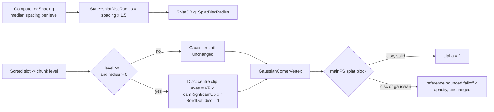

# Design: Splat coarse-level billboards

Requirements: [splat-coarse-level-billboards](../requirements/splat-coarse-level-billboards.md)
Status: agreed
Date: 2026-09-07

This is the public summary; implementation detail is kept in the private repository.

## Status, 2026-09-07 late
Level 0 draws as discs too for now (`kSplatDiscMinLevel = 0`), since the Gaussian level 0 is
switched off (`kSplatGaussianLevel0 = false` in `SplatPakApp.cpp`). Everything about the discs
themselves stands and now applies to every level.

## Revision, 2026-09-07 evening (final)
The clause "a level 0 chunk mid cross-fade is drawn as discs" is withdrawn, and so are the
intermediate forms tried the same evening (a per-pixel dither, an opacity ramp with the parent
discs solid, a per-record disc-to-Gaussian blend). The code now does this: level 0 never draws
discs; the disc condition is `lod >= kSplatDiscMinLevel` only. The level 1 to 0 hand-over is an
opacity cross-fade with no dither: the level 1 parent's discs fade out while the level 0
children's Gaussians fade in, and the Gaussian halos grow in as the fade progresses. The level 0
in view fades in together rather than chunk by chunk. See
[splat-transition-shimmer](splat-transition-shimmer.md), revision note. Everything about levels 1
and up stands.

## Summary
In splat mode the per-slot splat builder learns the chunk's level and, for level 1 and above, emits
a camera-facing disc instead of a projected Gaussian: a quad spanned by the camera's right and up
vectors scaled by the level's point spacing times 1.5, with the existing solid-dot rule for
sub-pixel discs. The disc reuses the Gaussian quad structure (clip-space centre plus two clip-space
half-axes), so the mesh and vertex shaders that place corners are unchanged. Discs use the splat
mode's own bounded Gaussian falloff (zero at the disc edge) times the record's opacity, so the pixel
shader only needs the `disc` interpolant to make sub-pixel solid dots opaque. Level 0 goes through
the untouched Gaussian code, byte for byte. The app hands the renderer one radius per level in a
new constant-buffer array, and the status banner names the rule. No UI, no config key, no format
change, and the withdrawn bleed mask stays out of the tree.

## Components touched
| Area | Files | Change |
|------|-------|--------|
| Splat shaders | `src/SplatCore/Shaders/Splats.hlsl` | `g_SplatDiscRadius[2]` in the constant buffer; `disc`/`solid` on `GaussianSplat`; `disc` interpolant on `VSOut`; `BuildGaussianSplat` takes the level and has a disc branch; `SplatFromSlot` passes the chunk level; `GaussianCornerVertex` copies `disc`/`solid`; `mainPS` disc branch inside the splat-mode block. |
| Renderer | `src/SplatCore/SplatRenderer.h`, `src/SplatCore/SplatRenderer.cpp` | `State::splatDiscRadius[8]`; `SplatCB::splatDiscRadius[8]` appended on a 16-byte row; filled in `OnRender`. |
| App | `src/SplatCore/SplatPakApp.cpp` | Per-frame copy of the level spacing times the coverage factor into `State::splatDiscRadius`; banner SPLAT line gains "levels 1+ as discs". |
| Docs | `docs/USER_GUIDE.md` | One sentence in the splat-mode description: every level above 0 draws as camera-facing discs sized from the level's point spacing. |

## Data flow

1. **Radius per level.** The app measures each level's median nearest-neighbour spacing on load
   (`ComputeLodSpacing`, one trace line per level), including for splat packages. Every frame it
   writes the spacing times a named constant `kSplatDiscCoverage = 1.5f` into
   `State::splatDiscRadius` (0 for levels without a measurement). The renderer copies it into the
   constant buffer. The Auto Splat Size checkbox and Coverage slider of the disc modes are not
   involved.
2. **Level at the slot.** `SplatFromSlot` passes the chunk's level into `BuildGaussianSplat` (0 when
   the pipeline is not chunked).
3. **Disc branch in `BuildGaussianSplat`.** After decoding position, opacity, DC colour and the SH
   scale, and after the view-space and clip-space centre with the existing depth clamp: when the
   level is at or above the threshold and its radius is above 0, build `tX = g_CamRight * r`,
   `tY = g_CamUp * r`, apply `SolidDot` with the distance from the viewer eye (the same call the
   disc modes make), then `axis1 = mul(g_ViewProj, float4(tX, 0)).xy`,
   `axis2 = mul(g_ViewProj, float4(tY, 0)).xy`. Because both tangents are perpendicular to the view
   direction, the corners share the centre's clip w and z, so the existing corner placement
   `clipCenter + (cc.x * axis1 + cc.y * axis2, 0, 0)` is exact. Reject when
   `abs(clip.xy) - (abs(axis1) + abs(axis2)) > clip.w` on either axis. Set `uvScale = 1`,
   `alpha = opacity`, `disc = 1`, `solid` from `SolidDot`. Otherwise fall through to the covariance
   path exactly as it is today, with `disc = 0`, `solid = 0`. The colour block (DC plus harmonics,
   clamp, optional linear conversion) is shared by both branches and is not reordered internally.
4. **Corner and interpolants.** `GaussianCornerVertex` copies `gs.disc` to the new `VSOut::disc`
   and `gs.solid` to the existing `VSOut::solid`. `CulledSplatVertex` and `SplatCornerVertex` set
   `disc = 0`.
5. **Pixel shader.** Inside the existing `g_RenderMode == 3` block, before the Gaussian falloff:
   `if (i.disc > 0.5 && i.solid > 0.5) return float4(i.color, 1.0);`. Everything else falls into
   the existing normalised falloff `(exp(-4 d) - e^-4) / (1 - e^-4) * splatAlpha`, which for a disc
   (uvScale 1, so `d` is 1 at the disc edge) reaches zero exactly at the rim. The `d > 1` discard at
   the top of `mainPS` clips the quad to the disc. The Gaussian arithmetic is untouched.
6. **Everything else** (sort, LOD cross-fade, occlusion depth test, blend space, temporal filter)
   sees a quad per slot as before.

## Render path impact
- **mesh:** `mainMS` calls `SplatFromSlot` and `GaussianCornerVertex` unchanged; the disc logic is
  inside the shared builder. `mainPS` gains the disc branch.
- **VS SM6:** `mainVS` uses the same shared builder and corner function; identical behaviour.
- **VS SM5 (FXC):** the same source compiles as vs_5_1/ps_5_1. The new code uses only `mul`, `exp`,
  `saturate` and array indexing into a `float4[2]` constant, which the legacy compiler already
  handles for `g_LodRadius`. No new resources or samplers.

## Public / private placement
All changes are public app code in `src/SplatCore` and `docs/`. The codec library, the package
format and the bake are untouched; the opacity already in coarse records is used as is. No public
file gains a dependency on a private path.

## Decisions
- **Disc as a Gaussian-shaped quad** (clip centre plus clip half-axes) rather than routing level 1+
  through the disc modes' `BuildSplat`/`SplatData` path: keeps one quad structure and one sort for
  splat mode, needs no per-splat normal, and leaves the mesh and vertex corner code untouched.
  Rejected: reusing `BuildSplat`, which expects packed point records and size classes that splat
  records do not have.
- **Dedicated `g_SplatDiscRadius` array** rather than reusing `g_LodRadius`: the disc modes'
  Coverage slider and Auto Splat Size checkbox must not change splat-mode discs, and the
  requirement fixes the multiplier. Eight floats appended at the end of the constant buffer on a
  16-byte boundary, guarded by a `static_assert` on the offset and size.
- **Level passed into the builder** rather than a separate disc builder called from the mesh and
  vertex shaders: one call site change in `SplatFromSlot`, zero changes in `mainMS`/`mainVS`.
- **Fallback to Gaussian when a level has no spacing** (radius 0): nothing can vanish if the
  measurement is missing; criterion 6 makes a missing measurement visible in the trace.
- **`SolidDot` reused verbatim** so far levels become opaque one-pixel dots as the disc modes do.
- **Bounded Gaussian falloff and 1.5 coverage for discs** (revised 2026-09-07): the disc-mode
  `exp(-2.5 d^2) x 0.9` rule left an eight-percent alpha ring at every disc edge and, at radius
  1.0, read as speckle next to level 0. Sharing the reference falloff removes the ring, matches the
  level-0 look, and needs no disc-specific alpha code beyond the solid-dot case.
- **Level-0 chunks mid cross-fade drawn as discs** (added and then withdrawn on 2026-09-07): on low
  bandwidth a chunk-by-chunk disc-to-Gaussian fade flickered. The final form is the opacity
  cross-fade described in the revision note, with level 0 always Gaussian.
- **Fixed threshold constant `kSplatDiscMinLevel = 1`** in the shader, no constant-buffer field: the
  requirement rules out a control, and a shader constant is the smallest change. (Was 2; lowered
  to 1 on 2026-09-07 because level 1 Gaussians flickered with glow against level 2 discs.)

## Test plan
- Existing test executables are unaffected (no codec, format or CPU-side geometry change); they
  must still build. Any pre-existing test failures unrelated to this change are reported as such.
- App smoke test, bundled Cthulhu splat package, Viewer mode, temporal filter off:
  1. Preview level forced to 1, 2, then 3: screenshots show discs, no halo past the rim (criterion 3).
  2. Preview level 0: screenshot numerically identical to a baseline build of the tree without this
     change (criterion 4).
  3. Level 1 view on `--render-path mesh`, `vs6`, `vs5`: numerically matching (criterion 5).
  4. Trace shows a non-zero ComputeLodSpacing value per level (criterion 6).
  5. Zoom through the level 0 to 1 transition: screenshot sequence shows the cross-fade, no popping
     (criterion 7).
  6. Main splat dispatch time at the level-1 view not above the baseline (criterion 8).
  7. Banner SPLAT line shows "levels 1+ as discs" (criterion 9).
  8. No bleed-mask residue: grep for `bleed_mask`, `BleedMask` in `src/`, `docs/USER_GUIDE.md`,
     `bin/ShaderLibDX` and `bin/config.json` after a run (criterion 2). A stale `BleedMaskCS.hlsl`
     copied into `bin/ShaderLibDX` by an earlier build is deleted.
- No new test executable.

## Risks
- **Coverage at level 1 and up.** The disc alpha is the bounded Gaussian falloff times the
  record's opacity, and coarse records carry an opacity tuned for Gaussians. If discs still read
  thin against the background, the remedies are a larger `kSplatDiscCoverage` or an opacity floor
  for discs, both one-line changes.
- **Look change across the level 0 to 1 cross-fade.** Gaussians and discs have different textures,
  so the fade will show a change in surface character. Accepted by the owner.
- **Spacing missing for a level** falls back to Gaussians for that level; the trace exposes it.
- **Constant-buffer layout.** Appending to `SplatCB` has bitten before (see the `lodRadiusAlign`
  comment). The `static_assert` and a first-frame visual check on all three paths guard it.

## Implementation outline
1. `SplatRenderer.h`: add `splatDiscRadius[8]` to `State` (world units, 0 = draw Gaussians) and
   append it to `SplatCB` on a 16-byte boundary with `static_assert`s on offset and size.
2. `SplatRenderer.cpp` `OnRender`: copy it into the constant buffer next to `lodRadius`.
3. `Splats.hlsl`: mirror the constant-buffer field as `float4 g_SplatDiscRadius[2]`; add
   `kSplatDiscMinLevel`; add `disc`/`solid` to `GaussianSplat` and `disc` to `VSOut`; add the disc
   branch to `BuildGaussianSplat` with a shared colour block; pass the level from `SplatFromSlot`;
   add the solid-dot early return in `mainPS`.
4. `SplatPakApp.cpp`: fill `splatDiscRadius` per frame from the measured spacing times
   `kSplatDiscCoverage`; extend the banner SPLAT line.
5. `docs/USER_GUIDE.md`: one sentence on coarse levels as discs.
6. Remove any bleed-mask residue; build all targets in Release and run on all three render paths.
