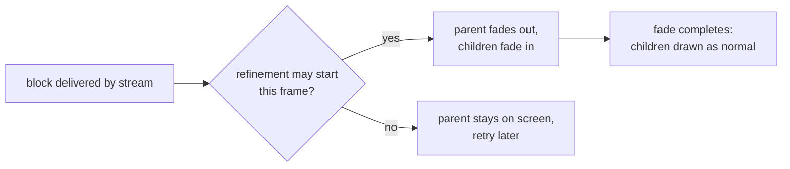

# Design: Splat transition shimmer

Requirements: [docs/requirements/splat-transition-shimmer.md](../requirements/splat-transition-shimmer.md)
Status: agreed
Date: 2026-09-07

This is the public summary; implementation detail is kept in the private repository.

## Status, 2026-09-07 late: Gaussian level 0 hand-over switched off
The special level 1 to level 0 hand-over described below is set aside. Every level of a splat
package now uses the ordinary dithered level transitions, and the hand-over code stays in place
but disabled. A 3DGS source still bakes its Gaussian data; only Match Level 0 Softness is greyed
out. Refinement pacing is unaffected.

## Revision, 2026-09-07 evening
The first design for the finest level (a per-pixel dither between two representations of each
splat) flickered and was withdrawn before it shipped. It was replaced by an opacity cross-fade:

- The parent blocks fade out in opacity while their children fade in, both drawn at full
  coverage. The two layers always add up to full coverage, so there is no stipple, no
  see-through and no halo flash, and the colour difference between the layers is only visible
  mid-fade, never at either end.
- The hand-over for the part of level 0 in view begins only when that part has finished
  streaming, so it fades in as one instead of sweeping across the model. The trade is that level 0
  is not shown until it is complete in view.
- Demotions and coarser refinements keep the dithered fade. The Dither Duration slider governs all
  of them.
- Rejected the same evening, because they flickered or flashed: a full-strength dither between
  representations, fading Gaussians in under solid parents, fading Gaussians in under dissolving
  parents, and a per-splat blend after a dithered fade.

Two follow-up fixes to the pacing, the same evening:

- **Arrival glow.** The Refinement Visualizer's glow ran from delivery, so a block whose start had
  been deferred appeared with its glow already over. The glow now starts on the block's first draw.
- **Growth order.** Deferred refinements were admitted in tree-walk order, so the model grew back
  in spatial order rather than the scheduler's. They are now admitted in the order they were
  delivered.

## Summary
Two changes, one per cause.

1. **Refinement pacing.** The streaming traversal limits how many new cross-fades may begin,
   so that the number of blocks mid-fade stays below the safety valve. A refinement that waits
   keeps showing its parent and tries again on a later frame.
2. **Finest level ease-in.** In splat mode the finest level eases in over the Dither Duration
   instead of changing representation in one frame (see the revision above for the form that
   shipped). Blocks resident at load skip the fade.

## Components touched
| Area | Change |
|------|--------|
| Streaming traversal | Paces when refinement cross-fades may begin; counts deferred starts. |
| Streaming tab | One new statistic: refinement starts deferred this frame. |
| Splat shader | Opacity weight for blocks in the finest-level hand-over; unchanged output at full weight. |
| Refinement Visualizer | Glow starts on first draw. |
| User guide | One sentence on refinement pacing and one on the finest-level ease-in. |

## Data flow

## Render path impact
All three render paths (mesh, VS SM6, VS SM5) share the same splat builder and pixel shader, so
the change appears identically on each. At full weight the shader output is arithmetically
unchanged.

## Public / private placement
The pacing sits in the viewer's traversal, after delivery. The streaming order, priorities and
delivery model are untouched.

## Decisions
- **Pace the visual hand-over rather than raise the safety valve.** The valve guards against a
  real GPU overload. Raising it would only make the snap happen later; pacing the stream itself
  would slow delivery, whereas only the visual hand-over needed bounding.
- **One control for every fade:** the existing Dither Duration slider. No new controls.
- **Blocks resident at load start fully faded in**, so a package opened with the streaming
  simulation off looks exactly as before.

## Test plan
- Existing test executables still build and pass.
- App smoke test in the Viewer with the bundled Cthulhu package, mesh path unless stated:
  1. The 5G refill repro, recorded as a frame sequence with the trace: the safety valve never
     fires, deferred starts appear during levels 1 and 0, and no region snaps.
  2. The finest level eases in; no single-frame change of representation.
  3. Refill time is comparable to the previous build.
  4. The settled level 0 view is pixel-identical to the streaming simulation off.
  5. Start-up with the streaming simulation off shows level 0 immediately, unchanged.
  6. A level 1 view and a settled level 0 view match across the mesh, VS SM6 and VS SM5 paths.
  7. A sustained refill with the D3D12 debug layer: clean, no device removal.
  8. A disc-mode refill: no snaps.
- No new test executable.

## Risks
- **Pacing delays the visual refill** at very high bandwidth. The data is already resident; only
  the hand-over waits. Criterion 5 is the check.
- **Blocks waiting to refine could be evicted** before their fade begins. At high bandwidth the
  wait is short.
