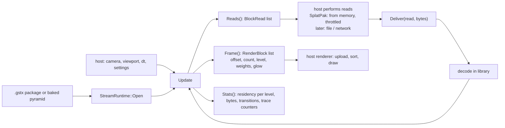

# Design: Streaming runtime in the codec library

Requirements: docs/requirements/stream-runtime-library.md
Status: agreed
Date: 2026-10-25

This is the public summary; implementation detail is kept in the private repository.

## Summary
The streaming runtime used to live inside `SplatPakApp` (about 2,200 lines of functions and member state). It moves into a new `StreamRuntime` module in `libs/bluesec-codec`. The app becomes a host: it opens the runtime on a loaded package or a baked pyramid, gives it the camera and settings each frame, performs the reads it asks for (in SplatPak, instantly from memory under the simulated bandwidth), and draws the render list it returns. Payload decoding (Brotli, byte shuffle, record decode) moves into the library too, so a host never sees the codec.

The work comes in three phases:
1. A mechanical move with identical behaviour, checked against traces recorded before the change.
2. The reader interface used for real reads.
3. The UE5 plugin adopts the runtime (separate design).

## Components touched
| Area | Files | Change |
|------|-------|--------|
| Library API (public header) | `libs/bluesec-codec/StreamRuntime.h` (new) | `StreamRuntime` class and plain data types: `StreamSettings`, `StreamCamera`, `BlockRead`, `RenderBlock`, `StreamStats`, `LevelStats`. No STL in the hot structs beyond `std::vector` (both hosts use the same MSVC runtime). |
| Library implementation (private) | `libs/bluesec-codec/StreamRuntime.cpp` (new, prebuilt) | The streaming runtime moved out of the app: residency, requests, delivery order, level changes, eviction, stats and trace lines. |
| Payload decoding (open) | `libs/bluesec-codec/PayloadDecode.h/.cpp` (new), `libs/bluesec-codec/brotli/` (moved from `libs/brotli`) | Brotli, byte shuffle and `SplatCodec` record decode of one chunk level, used by the runtime and by `StreamPackager`. Brotli's MIT `LICENSE` stays beside it and is listed in `NOTICE`. |
| Open stand-in | `libs/bluesec-codec/StreamRuntime.cpp` in the public tree (new) | Same API. Streams coarse-to-fine in chunk order with one model-wide level and instant level swaps. Decodes through the open `PayloadDecode`. |
| Library build | `libs/bluesec-codec/CMakeLists.txt` and its public stand-in | Add the new sources and the Brotli sources; drop `libs/brotli` from the top-level CMake. |
| App host | `src/SplatCore/SplatPakApp.cpp/.h` | Remove the moved code; hold a `std::unique_ptr<StreamRuntime>`; map UI controls to `StreamSettings`; convert `RenderBlock`s to `MeshletChunkGPU` for the renderer; read `StreamStats` for the residency graph, the Streaming tab readouts and the LOD calibration. |
| App packager | `src/SplatCore/StreamPackager.h`, `PayloadCodec.h` | Decode through the library's `PayloadDecode`; `PayloadCodec.h` keeps only the encoder side (bake). |
| Tests | `tests/TestStreamRuntime.cpp` (new), `tests/CMakeLists.txt` | GPU-free driver: opens Cthulhu, runs a scripted camera for N frames, prints per-level residency and render list size; deterministic. |
| UE5 plugin | `UE5Splats/Scripts/BuildCodec.ps1` | Default to the library's source checkout and stage the new header. (Plugin adoption is phase 3.) |
| Public history | release tooling | The public history is scrubbed of the moved code. |

## Data flow

- **Open.** From a loaded package (`SFLWPackageData`) or, in the bake tab, from the in-memory pyramid. The runtime keeps the decoded records of every resident block in one CPU arena, addressed by `RenderBlock::offset`.
- **Simulated network (SplatPak).** The host answers every `BlockRead` from the package bytes already in memory, up to the throttle's bytes per frame, so the network profiles, ring buffer limit and Evict behave as before.
- **Render list.** `RenderBlock { uint32 offset, count; uint8 level; float blendWeight; float opacityWeight; float glow; bounds }` carries exactly what the renderer's `MeshletChunkGPU` needs, so the host conversion is a straight copy.
- **GPU buffers.** Phase 1 keeps SplatPak's current model: every level is uploaded once and the render list references it, so `offset` is the unified-buffer offset. Phase 2 adds a slot allocator for a fixed GPU pool (the UE5 path).

## Render path impact
- mesh: none. The render list content is unchanged.
- VS SM6: none, same reason.
- VS SM5 (FXC): none, same reason.

## Public / private placement
- Public: `StreamRuntime.h`, the stand-in `StreamRuntime.cpp`, `PayloadDecode` (Brotli plus the documented record layout), the app host code and the test.
- Private: the real `StreamRuntime.cpp`, shipped prebuilt.
- No public file depends on a private one: the app includes only the header, and the stand-in builds whenever the prebuilt library is absent.

## Decisions
- **The codec and format are named GSTx** (user, 2026-10-25; it replaced the earlier choice, GStrX, the same day). Packages use the suffix `.gstx`. Proposed scope, folded into this change: the library (`libs/bluesec-codec` becomes `libs/gstx`, with its CMake target and prebuilt `.lib`), the UE5 ThirdParty module, the bake tab ("GSTx Bake"), the format spec, and a new format version whose magic is `GSTX`. `.sflw` packages keep loading. Bundled packages are re-baked as `.gstx`.
- **Decoding in the library** (user, 2026-10-25): one reader for every host, so the plugin gets format v9 for free. Rejected: a decoder per host.
- **The stand-in is simple but working** (user, 2026-10-25): coarse-to-fine, one level, instant swaps. Rejected: loading everything at once, and having no stand-in.
- **Mechanical move first.** Phase 1 moves code with no behaviour change and is accepted against traces recorded before the change, so a regression shows up as a difference in numbers, not something to spot by eye. Rejected: redesigning the runtime while moving it.
- **The runtime owns CPU-side decoded data; the host owns GPU memory.** Hosts differ most in how they manage GPU resources (D3D12 in SplatPak, RDG in Unreal).
- **Plain API, no read callbacks.** `Reads()` returns a list and the host calls `Deliver()`. A host can then read synchronously (SplatPak) or asynchronously (Unreal's async IO) without the runtime knowing. Rejected: a read callback, which forces one threading model.
- **Debug views read stats.** The residency graph and the streaming trace lines read `StreamStats` and per-block state through a read-only query; nothing in the runtime knows about ImGui.
- **Disabled experimental code is dropped**, not moved. It stays in the private history if it is ever revived.

## Test plan
- **Before any code moves**, record a baseline on the Cthulhu package: the `--lod-calibration` report, and a scripted Evict at 5G with the loupe on the face, keeping the streaming trace log.
- After the move, rerun both and diff (acceptance criteria 3 and 4). Splat counts must be identical; delivery totals within 5% (frame timing differs from run to run).
- `TestStreamRuntime` (new): deterministic per-level residency after a scripted camera path. Run twice, the outputs are identical. Run against the stand-in, the outputs differ but the model reaches full residency.
- Existing tests: `TestLoadPackage`, `TestSplatCodec`, `CompressVenus` and `TestOcclusionVolume` must pass, and so must `tests/stress_test.py` (it loads and streams packages).
- App smoke test: the Streaming tab controls (criterion 5), Conservative with the delivery trace, Studio and Viewer.

## Risks
- **Behaviour drift during the move.** The runtime carries state from frame to frame that is easy to reorder by accident. Mitigation: move the code verbatim first and diff against the baseline traces.
- **Hidden coupling to the renderer.** The old code read some app and renderer state directly. Mitigation: everything the runtime needs comes in through `StreamCamera` and `StreamSettings`; the one renderer dependency belonged to disabled code, which is dropped.
- **Bake-tab preview.** The bake tab streams an in-memory pyramid, not a package. Mitigation: `Open` accepts either source.
- **Moved code in older public history.** Mitigation: scrub it from the public history and check before publishing.
- **Size of the change.** About 2,500 lines move. Mitigation: land it in three commits (decoding into the library; the runtime with the app switched over; the stand-in and test), each building and passing.

## Implementation steps
1. **Baseline.** Record the calibration report and the 5G Evict trace on the current build. Done when: the baseline files exist.
2. **Payload decoding in the library** (`PayloadDecode`, Brotli moved under the library). Done when: `TestLoadPackage` and `TestSplatCodec` pass and SplatPak opens every bundled package.
3. **Public header** `StreamRuntime.h`. Done when: it compiles standalone.
4. **Runtime implementation** in the library. Done when: it compiles in the library with every trace line's text unchanged.
5. **App switched to the runtime.** Done when: acceptance criteria 1, 3, 4 and 5 hold against the baseline.
6. **Open stand-in** and its CMake. Done when: criterion 7 holds with `-DBLUESEC_CODEC_USE_PREBUILT=OFF`.
7. **`TestStreamRuntime`.** Done when: criterion 6 holds.
8. **Public history scrub.** Done when: the public history contains none of the moved code.
9. **UE5Splats staging script.** Done when: criterion 8 holds.
10. **Docs:** `README.md` (component list), `libs/bluesec-codec/README.md` (the runtime and its stand-in) and `NOTICE` (Brotli inside the library). Done when: they describe the new layout.
