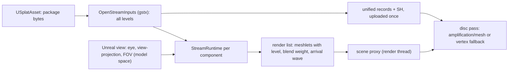

# Design: Streaming and the refinement visualizer in the UE5 plugin

Requirements: the Goals section below (user, 2026-10-26: "give the unreal engine the refinement visualizer as well, so I can see in the level how it is streamed in"; real streaming first)
Status: built (2026-10-26), with the differences under "As built"; agreed (user, 2026-10-26: "proceed with all as recommended")
Date: 2026-10-26

## Summary
The SplatPak plugin decodes one level of a package when it loads and draws it for good. This change makes each placed model stream the way SplatPak does: the plugin hosts the library's `StreamRuntime`, feeds it the Unreal camera every frame, and draws the render list it returns, with per-block levels, cross-fades, Release Unused LOD Segments and the refinement visualizer's per-level arrival tint. Like SplatPak today, the network is simulated: every level is decoded into memory when the asset loads, and the runtime decides what is resident and drawn under a bandwidth budget. Real reads from disk (the runtime's `Reads()` / `Deliver()` phase) are a later step and do not change anything built here.

## Goals
1. A placed splat model streams in, coarsest level first, in the codec's delivery order, at a bandwidth set on the component; the refinement visualizer tints each arriving chunk in its level's colour (the same colours and fade as SplatPak) so the stream is visible in the level.
2. The level of detail follows the Unreal camera: in the editor the active level viewport, in Play-In-Editor and in a game the player's camera. Per-block levels and Release Unused LOD Segments behave as in SplatPak.
3. Controls on the actor (the component's Details panel): streaming on/off, bandwidth (the network profiles), Release Unused LOD Segments (user, 2026-10-26: the actor has this check too), Per-Block Levels and the pixel threshold, Refinement Visualizer (intensity, hue, fade duration), and a red Evict button (user, 2026-10-26) that drops everything but the two coarsest levels so the model streams in again, as SplatPak's Evict does. Unreal draws Details-panel buttons in one style, so the red one needs a details customization in the editor module (`SplatPakEditor`).
4. Both render paths (amplification + mesh shaders, and the vertex fallback) draw the render list; occlusion culling keeps working.
5. SplatPak's behaviour is unchanged: the library changes are additive, and TestStreamRuntime's output is identical before and after.

## Components touched
| Area | Files | Change |
|------|-------|--------|
| Library types | `libs/gstx/GstxTypes.h` (new), `src/SplatCore/WaveletTypes.h` | The types the library's public headers need (`SplatPoint`, `PackedPointGPU`, `PackedSplatGPU`, `MeshletChunkGPU`, the bounds helpers) move into a library header; `WaveletTypes.h` includes it. Today `StreamRuntime.h`, `StreamOrder.h` and `DetailHeatmap.h` include `../../src/SplatCore/WaveletTypes.h`, which the plugin's staged headers cannot resolve. |
| Library camera | `libs/gstx/StreamRuntime.h/.cpp` | `StreamCamera` gains an explicit view: `eye`, `viewProj` (model space) and `fovY`, used instead of the orbit parameters when `explicitView` is set: frustum planes, eye position, `LodFocalPixels` (today a fixed 45 degrees) and the camera-moved test. SplatPak keeps the orbit fields. |
| Library open | `libs/gstx/StreamInputs.h/.cpp` (new) | `OpenStreamInputs(package bytes) -> StreamInputs`: every level decoded into `ResidentLOD`s (records, SH, positions, meshlets of 64 in Morton order), bounds, the level-sorting frame, the detail grid and the splat parameters: what SplatPak assembles today in `LoadSFLWFile` / `BuildResidentLODs` with `StreamPackager` and `SpatialOctree`. The plugin calls it; SplatPak can move onto it later. |
| Open stand-in | `scripts/public-release-stubs/libs/gstx/` | `StreamInputs.cpp` (open: decoding is open already); the stand-in `StreamRuntime.cpp` honours the explicit camera. |
| Plugin asset | `USplatAsset` | `GetStreamInputs()`: opens all levels once (cached, shared by every component using the asset). |
| Plugin component | `USplatComponent` | The settings of Goal 3; ticks in the editor and in game; finds the view (active level viewport, or the player camera manager), converts it to model space (the component transform with the Y-up to Z-up conversion), runs `UpdateStreamingSimulation`, and sends the render list (`FrameChunkCount()` meshlets) to the scene proxy. One runtime per component. |
| Plugin rendering | `FSplatDrawable`, `SplatShaders.h`, `SplatDisc.usf` | Records and SH of every level uploaded once (the unified buffers the meshlets' `splatOffset` refers to); the meshlet buffer re-uploaded each frame from the render list. The disc shader reads each meshlet's `LodLevel`, `BlendWeight` (dithered cross-fade, 8x8 Bayer, SplatPak's sign convention) and `IsSilhouette` (the arrival wave), and applies `ArrivalGlow` with the level hue table. |
| Plugin tests | `SplatPakRendering` tests | A runtime test on a bundled scan: scripted camera, N frames; the render list starts at the coarsest level, refines, and every meshlet's records lie inside the uploaded buffers. |
| Sample scene | `UE5SplatStream` test scene | The sample model streams with the visualizer on. |

## Data flow

## Render path impact
- Mesh shaders: the amplification shader walks the frame's meshlet list instead of the static one; frustum and occlusion tests unchanged.
- Vertex fallback: one instance per splat slot of the frame's meshlets.
- SplatPak: none (library changes are additive).

## Public / private placement
- Public: `GstxTypes.h`, `StreamInputs.h/.cpp`, the `StreamCamera` addition, the plugin code.
- Private: the real `StreamRuntime.cpp` changes for the explicit camera.

## Decisions (proposed)
- **Simulated network, everything decoded at load**, as SplatPak does. What you see stream is the runtime's real behaviour; memory is the full package (Cthulhu: about 405 MB CPU and GPU). Real reads come with the runtime's `Reads()` / `Deliver()` phase.
- **One runtime per component**, each with its own bandwidth budget. A shared budget across models is later work.
- **The editor follows the active level viewport**, so moving the editor camera streams and refines the model in place.

## Open questions
- Should several components using one asset share one runtime when they are instances of the same model? (Proposed: no, each streams on its own.)